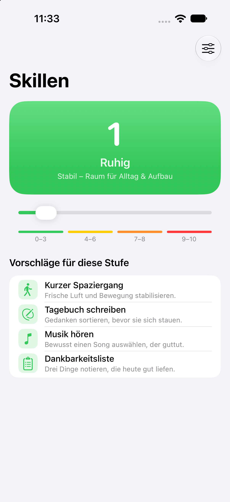
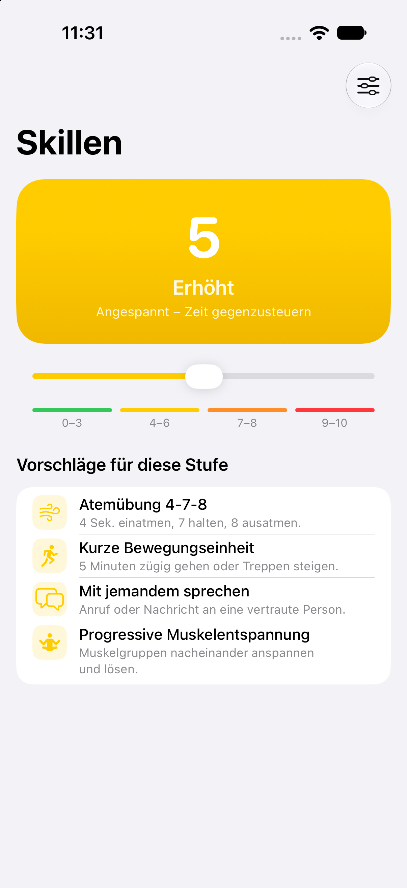

# Skills

An iOS app (SwiftUI, iOS 17+) that helps you pick coping skills matched to your current inner tension. Set a tension level from 0 to 10 and the app suggests suitable skills for that zone. The UI is in German.

<p align="center">
  
  &nbsp;
  
</p>

## Features

- **Tension slider** with four zones: Ruhig (0–3), Erhöht (4–6), Hoch (7–8) and Krise (9–10)
- **Standard skills** for each zone, which you can show or hide
- **Custom skills** that you add, edit and manage yourself
- **Crisis contacts** (Die Dargebotene Hand 143, Notruf 112) with one-tap calling

## Requirements

- Xcode 15 or later
- [XcodeGen](https://github.com/yonaskolb/XcodeGen) (optional, to regenerate the project from `project.yml`)

## Build

```sh
xcodegen generate   # optional
open Skills.xcodeproj
```

Then select an iOS 17+ simulator or device and run.

## Project structure

```
Skills/
├── Models/   Skill and tension-zone data, preferences
├── Views/    SwiftUI views
└── SkillsApp.swift
project.yml   XcodeGen project definition
```

## Disclaimer

This app is a self-help aid and is not a substitute for professional help. In an emergency, call 112 or 143.
